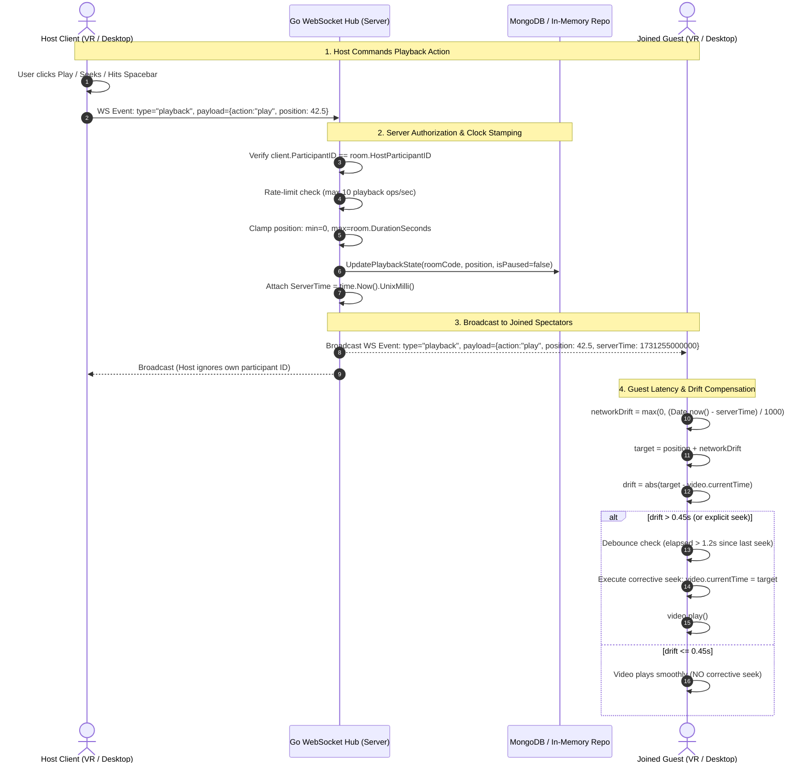

# Spatial Watch — Streaming Synchronization Architecture & Implementation Process

This document provides a comprehensive deep-dive into how real-time streaming synchronization between room hosts and joined participants is designed, implemented, and verified in **Spatial Watch**.

---

## 1. Executive Summary & Design Principles

Synchronizing multi-user video playback across desktop browsers and standalone WebXR headsets (e.g., Meta Quest Browser) introduces strict real-time constraints:
- **Audio/Video Decoder Sensitivity:** Repeatedly forcing video elements to seek (`video.currentTime = X`) over millisecond-level network discrepancies causes audio mute drops, decoder thrashing, frame drops, and severe motion discomfort in VR headsets.
- **Clock Drift & Latency Variation:** Participants experience fluctuating network Round Trip Times (RTT), varying buffer states, and device clock skew.
- **Host Authority vs. Spectator Consensus:** Decentralized peer-to-peer sync easily creates split-brain playback loops when network packets arrive out of order.

To resolve these challenges, Spatial Watch enforces a **Host-Authoritative, Server-Mediated, Drift-Tolerant Clock Model**:

```
[ Host Client ] ──(Playback Actions)──► [ Go WebSocket Hub ] ──(Timestamped Events)──► [ Joined Clients ]
      │                                          │                                            │
  Local UI                                MongoDB / Memory                              Drift Window
  Authority                               State Persistence                             (±450ms & Debounce)
```

1. **Host-Only Authority:** Only the room host can initiate playback commands (`play`, `pause`, `seek`).
2. **Server-Mediated Clock:** The Go backend serves as the single source of truth, stamping events with monotonic server time and tracking playback progress across network hops.
3. **Drift-Tolerant Client Compensation:** Joined guests compute latency-compensated playback targets and apply a **450ms tolerance window** and a **1200ms debounce guard** to eliminate decoder stutter.
4. **Hardware-Paced WebGL Textures:** Video frames are uploaded to Three.js WebGL textures strictly via `requestVideoFrameCallback` (rVFC), decoupling VR head tracking (72–120 Hz) from video decode rates (24–60 fps).

---

## 2. End-to-End Synchronization Architecture



---

## 3. Host-Only Authority & Security Enforcement

### 3.1 Client-Side Control Gating
In [`frontend/js/app.js`](file:///home/aeemars/Downloads/spatial%20watch/frontend/js/app.js), the user interface adapts based on the participant's role:

```javascript
function updateCinemaControlsAuthority(hostMode) {
  const playbackGroup = document.getElementById('cinema-playback-group');
  const broadcastIndicator = document.getElementById('cinema-broadcast-indicator');
  const progressBar = document.getElementById('cinema-progress');

  // Play/pause and seek buttons only visible to host
  if (playbackGroup) playbackGroup.hidden = !hostMode;
  
  // Guests see "Screening broadcast by Host" indicator
  if (broadcastIndicator) broadcastIndicator.hidden = hostMode;

  // Progress scrub bar is disabled and marked read-only for guests
  if (progressBar) {
    if (hostMode) {
      progressBar.classList.remove('is-readonly');
      progressBar.removeAttribute('disabled');
    } else {
      progressBar.classList.add('is-readonly');
      progressBar.setAttribute('disabled', 'true');
    }
  }
}
```

Keyboard shortcuts (`Space`, `k`, `ArrowLeft`, `ArrowRight`) and in-VR hand pinch gestures on playback controls are blocked for non-hosts:
```javascript
if (!isHost) {
  showToast('Playback is controlled by the screening host', 'info');
  return;
}
```

### 3.2 Server-Side Token Verification
Client-side UI disabling alone is insufficient for security. In [`backend/websocket/hub.go`](file:///home/aeemars/Downloads/spatial%20watch/backend/websocket/hub.go#L125-L150), incoming playback WebSocket events are strictly verified against the database entity:

```go
func (h *Hub) handlePlayback(client *Client, event *models.WSEvent) {
    // 1. Rate Limiting: 10 playback commands/sec max per participant
    if !h.rateLimiter.Allow(client.ParticipantID, "playback", 10, time.Second) {
        return
    }

    // 2. Room Host Check
    ctx, cancel := context.WithTimeout(context.Background(), 5*time.Second)
    defer cancel()

    room, err := h.roomRepo.FindByCode(ctx, client.RoomCode)
    if err != nil || room.HostParticipantID != client.ParticipantID {
        client.SendMessage(mustJSON(&models.WSEvent{
            Type:    "error",
            Payload: map[string]string{"message": "Only the host can control playback"},
        }))
        return
    }

    // 3. Payload validation, sanitization & boundary clamping
    action := strings.ToLower(strings.TrimSpace(payload.Action))
    if action != "play" && action != "pause" && action != "seek" {
        return
    }
    if math.IsNaN(payload.Position) || math.IsInf(payload.Position, 0) || payload.Position < 0 {
        payload.Position = 0
    }
    if room.DurationSeconds > 0 && payload.Position > room.DurationSeconds {
        payload.Position = room.DurationSeconds
    }

    payload.ServerTime = time.Now().UnixMilli()
    
    // 4. State Persistence
    isPaused := payload.Action == "pause"
    h.roomRepo.UpdatePlaybackState(ctx, client.RoomCode, payload.Position, isPaused)

    // 5. Broadcast to room
    event.Payload = payload
    h.BroadcastToRoom(client.RoomCode, event, nil)
}
```

---

## 4. Drift Compensation & Smooth Pacing Algorithm

The core client algorithm resides in [`syncPlaybackState`](file:///home/aeemars/Downloads/spatial%20watch/frontend/js/app.js#L1708-L1765).

### 4.1 Mathematical Latency Adjustment
When a packet travels from the host through the server to a joined user, network transit introduces latency. The client compensates by adding the elapsed transit time to the reported position:

$$\Delta t_{\text{transit}} = \max\left(0, \frac{T_{\text{client}} - T_{\text{server}}}{1000}\right)$$

$$P_{\text{calculated}} = P_{\text{target}} + \Delta t_{\text{transit}} \quad (\text{if playing})$$

$$\text{Drift} = \left| P_{\text{calculated}} - t_{\text{video, current}} \right|$$

### 4.2 The 450ms Drift Tolerance Window
Standard media decoders suffer when micro-adjustments are applied continuously. Testing demonstrated that forcing seeks for minor shifts ($< 400\text{ms}$) introduces visible micro-stutter, audio pop artifacts, and dropped VR frames.

* If $\text{Drift} \le 0.45\text{s}$: The video continues uninterrupted. Human perception perceives dialogue and visuals within 450ms across separate devices as completely in sync.
* If $\text{Drift} > 0.45\text{s}$: A corrective seek is required to realign the spectator with the host.

### 4.3 Debouncing Corrective Seeks
During network congestion, multiple WebSocket packets or background room reconciliations may arrive within milliseconds. To prevent "seek thrashing" (re-seeking before the decoder finishes buffering the previous seek):

```javascript
const DRIFT_TOLERANCE_SECONDS = 0.45; // 450ms window
const CORRECTION_DEBOUNCE_MS = 1200;  // 1.2s debounce between corrective seeks
let lastCorrectiveSeekTime = 0;

function syncPlaybackState(targetPosition, isPaused, serverTimestamp, forceSeek = false) {
  const currentVideoTime = Cinema.getCurrentTime();
  let calculatedPosition = typeof targetPosition === 'number' ? targetPosition : 0;

  if (!isPaused && typeof serverTimestamp === 'number' && serverTimestamp > 0) {
    const networkDrift = Math.max(0, (Date.now() - serverTimestamp) / 1000);
    calculatedPosition += networkDrift;
  }

  const drift = Math.abs(calculatedPosition - currentVideoTime);

  // Scenario 1: Target state is Paused
  if (isPaused) {
    if (Cinema.isPlaying()) Cinema.pause();
    if (forceSeek || drift > 0.1) {
      Cinema.seek(calculatedPosition);
    }
    return;
  }

  // Scenario 2: Spectator video is currently stopped/paused but room is playing
  if (!Cinema.isPlaying()) {
    Cinema.seek(calculatedPosition);
    Cinema.play();
    lastCorrectiveSeekTime = Date.now();
    return;
  }

  // Scenario 3: Both are playing - apply tolerance and debounce
  if (drift > DRIFT_TOLERANCE_SECONDS || forceSeek) {
    const now = Date.now();
    if (forceSeek || now - lastCorrectiveSeekTime > CORRECTION_DEBOUNCE_MS) {
      lastCorrectiveSeekTime = now;
      Cinema.seek(calculatedPosition);
    }
  }
}
```

### 4.4 Force-Seek Bypass
When the host explicitly jumps to a scene (scrubbing the timeline or hitting $\pm 10\text{s}$ skips), the event carries `action: 'seek'`. The client passes `forceSeek = true`, immediately overriding both the 450ms tolerance threshold and the 1200ms debounce timer so that all clients snap to the new timestamp simultaneously.

---

## 5. Dynamic Catch-Up for Late-Joining Users

When a new user joins a screening room that has already been running for 30 minutes, they must not start at 0:00.

### 5.1 Elapsed Time Extrapolation (Server-Side)
When handling `request_sync` or `GET /api/rooms/{code}` ([`backend/websocket/hub.go`](file:///home/aeemars/Downloads/spatial%20watch/backend/websocket/hub.go#L260-L285)), the Go backend dynamically extrapolates the ongoing position using the last state transition timestamp:

```go
currentPosition := room.PlaybackPositionSeconds
if !room.IsPaused && !room.UpdatedAt.IsZero() {
    elapsedSeconds := time.Since(room.UpdatedAt).Seconds()
    currentPosition += elapsedSeconds
}
if room.DurationSeconds > 0 && currentPosition > room.DurationSeconds {
    currentPosition = room.DurationSeconds
}
```

### 5.2 Two-Stage Initialization (Client-Side)
In [`frontend/js/app.js`](file:///home/aeemars/Downloads/spatial%20watch/frontend/js/app.js#L1420-L1435):
1. **Stage 1 (HTTP Initial State):** The guest fetches room data via `API.getRoom(roomCode)`.
2. **Stage 2 (Media Readiness Gating):** Playback does **not** begin until `HTMLVideoElement` triggers `canplay` / `loadedmetadata`. Once buffered:
   ```javascript
   Cinema.init(room.mediaUrl, isHost, () => {
       if (!room.isPaused) {
           const elapsed = (Date.now() - new Date(room.updatedAt).getTime()) / 1000;
           Cinema.seek(room.playbackPositionSeconds + elapsed);
           Cinema.play();
       } else {
           Cinema.seek(room.playbackPositionSeconds);
       }
   });
   ```
3. **Stage 3 (Live WebSocket Stream):** The client opens WebSocket connection `/ws?roomCode=...` and receives ongoing broadcast events.

---

## 6. WebXR Frame Pacing & WebGL Texture Pipeline

In Meta Quest WebXR, traditional DOM video rendering cannot be used. The video must be mapped to a 3D geometry screen inside Three.js. Naive rendering loops upload video frames on every single VR render tick ($72\text{--}120\text{ Hz}$), causing catastrophic memory bus stalls on mobile chipsets.

```mermaid
flowchart LR
    subgraph Browser ["Hardware Video Pipeline"]
        V["HTMLVideoElement (H.264 / AAC)"]
        rVFC["requestVideoFrameCallback (24 / 30 / 60 fps)"]
        Flag["isVideoTextureDirty = true"]
        V -->|New Decoded Frame| rVFC --> Flag
    end

    subgraph ThreeJS ["Authoritative WebXR Render Loop (72 / 90 / 120 Hz)"]
        Loop["renderer.setAnimationLoop(animate)"]
        Check{"isVideoTextureDirty == true?"}
        Upload["videoTexture.needsUpdate = true"]
        Clear["isVideoTextureDirty = false"]
        Render["renderer.render(scene, camera)"]

        Loop --> Check
        Check -->|Yes| Upload --> Clear --> Render
        Check -->|No (Idle Frame)| Render
    end

    Flag -.-> Check
```

### 6.1 `requestVideoFrameCallback` (rVFC) Integration
In [`frontend/js/cinema.js`](file:///home/aeemars/Downloads/spatial%20watch/frontend/js/cinema.js#L155-L180):
* Instead of copying pixels every tick, `registerVideoFrameCallback` listens directly to the hardware video decoder.
* `videoTexture.needsUpdate = true` is only flagged when a genuinely new video frame has been presented by the decoder.
* If a 24 fps movie is playing inside a 90 Hz Quest 3 session, the GPU texture upload runs exactly 24 times per second—saving ~73% of memory bus bandwidth.

### 6.2 Safe Fallback for Older Browsers
If `requestVideoFrameCallback` is absent:
```javascript
if (video && (!video.paused || video.seeking)) {
  const curTime = video.currentTime;
  if (curTime !== lastFallbackVideoTime || video.seeking) {
    lastFallbackVideoTime = curTime;
    if (videoTexture) videoTexture.needsUpdate = true;
  }
}
```

### 6.3 Resolution & DPR Adaptation
Headset displays feature high native physical resolutions. To prevent thermal throttling:
* In VR (`isPresenting = true`): Device Pixel Ratio (DPR) is capped to `1.0`.
* On Desktop: DPR is capped to `1.5` to prevent 4K fill-rate stalls.

---

## 7. Media Delivery & Fast-Start Streaming

Synchronization accuracy depends on rapid byte-range access. Spatial Watch implements a multi-tiered media delivery architecture:

```
[ Host: Local MP4 File ] ─────────► URL.createObjectURL(file) ─────────► [ Instant Host Cinema (0s Buffering) ]
           │ (Background Upload)
           ▼
[ Go Backend: faststart.go ] ─────► Moov Atom Reordered to Start of File
           │
           ▼
[ Cloudflare R2 Object Storage ] ──► Accept-Ranges: bytes ──────────────► [ Joined Guests: Zero-Wait Chunk Streaming ]
```

1. **Host Local Blob Seeding ([`seedMediaBlob`](file:///home/aeemars/Downloads/spatial%20watch/frontend/js/cinema.js#L30-L55)):** When a host selects a file from disk, the host's cinema immediately plays from an in-memory `Blob` object URL. There is zero upload wait time before the host can preview the screening.
2. **MP4 Fast-Start Processing ([`backend/handlers/upload_faststart.go`](file:///home/aeemars/Downloads/spatial%20watch/backend/handlers/upload_faststart.go)):** Uploaded videos have their `moov` atom (index headers) relocated to the very beginning of the file. Joined users can begin streaming chunk 0 within milliseconds without waiting for the entire multi-gigabyte file to download.
3. **HTTP 206 Partial Content (Range Requests):** Both the local Go server and Cloudflare R2 supply `Accept-Ranges: bytes` headers, allowing spectator video players to seek to arbitrary positions instantly.
4. **Anti-Latching Error Recovery:** If a spectator's connection briefly drops, [`retryStream`](file:///home/aeemars/Downloads/spatial%20watch/frontend/js/cinema.js#L540-L580) clears the HTML5 video error state and attempts re-initialization without requiring a browser reload.

---

## 8. Process & Engineering Evolution (Changelog)

The implementation of streaming synchronization progressed through four key development phases:

| Phase & Commit | Engineering Challenge | Solution Implemented |
|---|---|---|
| **Phase 1: Basic WebSocket Relay**<br>`commit 38ae6f0` | Naive broadcast had no concept of host authority. Any user could trigger pause/play. | Introduced basic WebSocket Hub and broadcast routing in `hub.go`. |
| **Phase 2: Fast-Start & Buffer Removal**<br>`commit 1d09cdf`, `b802ea8` | Joined spectators suffered 5–15s initial buffering stalls before playback began. | Added MP4 faststart atom reordering, byte-range headers, and local blob seeding for host. |
| **Phase 3: WebXR Pacing & Drift Tolerance**<br>`commit 1152cde` | Unconditional seeks on every state packet caused audio pop artifacts and VR motion sickness. | Implemented `DRIFT_TOLERANCE_SECONDS` (450ms), `CORRECTION_DEBOUNCE_MS` (1200ms), and `requestVideoFrameCallback` WebGL texture pacing. Created `tests/frame_pacing.test.js`. |
| **Phase 4: Host Authority & Presence**<br>`commit 465f138` | Guests could manipulate timeline scrubbers. Desynchronization occurred when guests paused locally. | Fully gated cinema controls to host only. Server-side host ID verification. Added read-only scrubbers, broadcast indicators, and real-time seat presence markers. |

---

## 9. Automated Verification & Test Coverage

The synchronization engine is protected by automated tests in both Node.js and Go:

### 9.1 Frame Pacing & Drift Tolerance (`tests/frame_pacing.test.js`)
* **Test 1:** Verifies authoritative render loop cleans up completely via `renderer.setAnimationLoop(null)`.
* **Test 2 & 3:** Confirms `requestVideoFrameCallback` dirties textures only when new frames decode, and fallback dirtying only occurs when `currentTime` advances.
* **Test 4:** Asserts VR DPR is capped at 1.0 and Desktop DPR is capped at 1.5.
* **Test 5 (Drift Tolerance):**
  - Asserts drift $< 0.45\text{s}$ does **NOT** trigger a seek.
  - Asserts drift $> 0.45\text{s}$ triggers a single corrective seek.
  - Asserts back-to-back seeks within $1200\text{ms}$ are debounced.
  - Asserts explicit host seeks (`forceSeek = true`) bypass tolerance and debounce immediately.

### 9.2 Backend WebSocket & Authority Tests (`backend/handlers/` & `backend/websocket/`)
* **Host Authority:** Verifies non-host WebSocket playback events are rejected with an error event.
* **Playback Clamping:** Tests negative timestamps, NaN, infinity, and positions exceeding total video duration.
* **Dynamic Join Math:** Validates that `request_sync` returns `position + time.Since(updatedAt)` for running screenings.

---

## 10. Summary Table of Key Constants

| Parameter | Location | Value | Rationale |
|---|---|---|---|
| `DRIFT_TOLERANCE_SECONDS` | `frontend/js/app.js` | `0.45` (450ms) | Prevents video decoder re-seeking and audio muting over minor network variances. |
| `CORRECTION_DEBOUNCE_MS` | `frontend/js/app.js` | `1200` (1.2s) | Prevents consecutive seek thrashing during network jitter. |
| Playback Rate Limit | `backend/websocket/hub.go` | `10 / sec` | Mitigates client scrub spam from overwhelming WebSocket broadcast queues. |
| VR Pixel Ratio | `frontend/js/cinema.js` | `1.0` | Prevents GPU fill-rate exhaustion on mobile XR2 chipsets. |
| Desktop Pixel Ratio | `frontend/js/cinema.js` | `1.5` | Balances retina display crispness with frame pacing stability. |
| Presence Heartbeat / Ping | `backend/websocket/client.go` | `30s / 60s` | Ensures dead connections and closed browser tabs disconnect cleanly. |


Aeeem